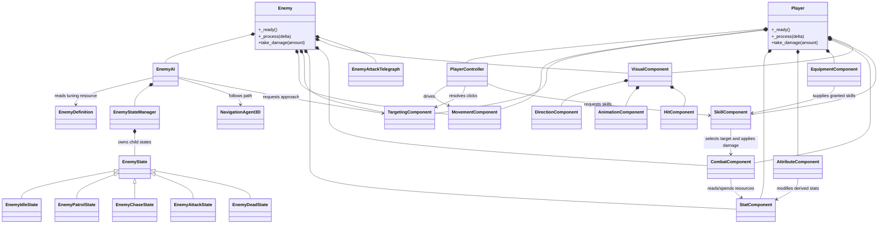
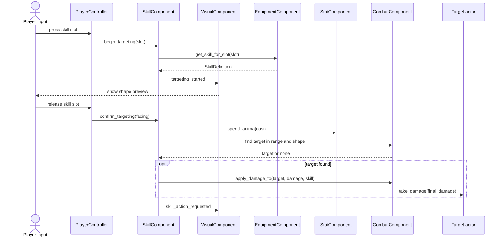
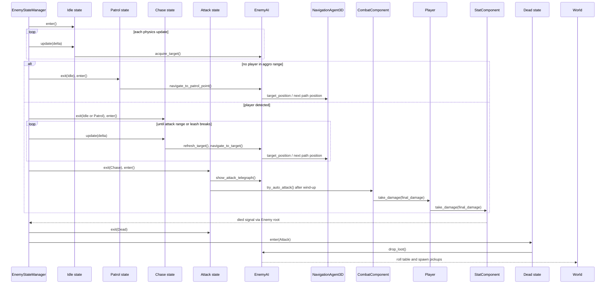
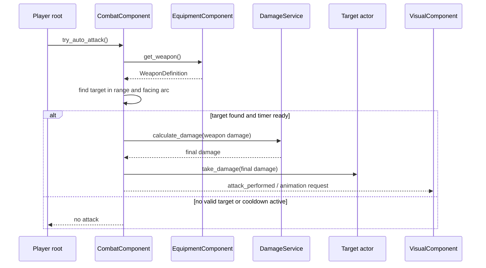
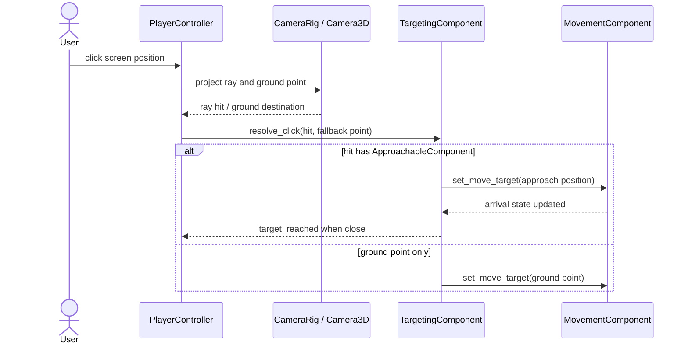

# Slayent Prototype

This repository contains a Godot prototype centered on a small movement and combat sandbox. This README documents the systems currently represented in the project and separates them from the larger vertical-slice goals in `AGENTS.md`.

## 1. Overview and current scope

The current prototype demonstrates a component-based player, equipment-granted skills, auto-attacks, Anima, basic attributes, combat presentation, collectible loot, and a gamepad-navigable inventory/equipment screen in a test arena. The full extraction ARPG loop remains incomplete: crafting, persistence, Shroud, extraction, and progression trees are still planned.

The project uses a hybrid presentation direction: a 3D test environment with billboarded 2D character sprites. The sandbox is the primary way to explore the current implementation.

## 2. Run the sandbox and controls

Run `scenes/movement_sandbox.tscn`. It creates a placeholder arena containing the player, a training dummy, an enemy, and approachable chest/interactable props, then binds the combat and debug HUDs.

| Input | Action |
|---|---|
| Left stick | Move relative to the camera and set facing |
| Left click | Move toward ground, approach interactables, or approach enemies and auto-attack at weapon range |
| Q / W / E / R / T / Y | Activate skill slots 1–6 |
| Gamepad X / Y / RB / LB / RT / LT | Activate skill slots 1–6 |
| B / Space | Cancel active targeting; otherwise request a dash |
| Right click | Cancel active targeting |
| F / Gamepad A | Open a nearby chest |
| I / Gamepad Start | Open or close the inventory screen |
| Debug key | Toggle the debug HUD |

There is no attack input: the player automatically attacks an enemy in weapon range and facing arc. The right stick has no gameplay action, and there is no separate aim input. While a skill preview is active, movement remains available and the skill executes using the facing direction at confirmation.

### Skill and gear slot mapping

| Skill slot | Gear slot | Keyboard | Controller |
|---:|---|---|---|
| 1 | Head | Q | X |
| 2 | Body | W | Y |
| 3 | Legs | E | RB |
| 4 | Feet | R | LB |
| 5 | Hands | T | RT |
| 6 | Weapon | Y | LT |

Gear slot enum values are zero-based (`EquipmentDefinition.GearSlot.HEAD` through `WEAPON`); skill slots are one-based to match input actions.

## 3. Current features by system

### Actor movement and targeting

- Player and enemy roots use `CharacterBody3D` and delegate movement, stats, combat, and presentation to child components.
- The player supports camera-relative gamepad movement and mouse click-to-move using a camera raycast and ground projection.
- Clicking an enemy sets a live attack approach target: the player replaces any old move target, closes to just inside weapon range, faces the enemy, and auto-attacks. Clicking nodes with `ApproachableComponent` approaches them; clicking ground remains click-to-move. Chest opening is a separate nearby Interact action.
- Dash uses Anima, has a cooldown, and grants a short invulnerability window. Movement also handles stagger and knockback.
- `CameraRig` follows the player with an orthographic camera and provides ground projection for mouse input.

### Combat and damage

- `CombatComponent` automatically finds a visible target in the configured group within weapon range and attack arc.
- Weapon data controls auto-attack damage, range, interval, arc, and shared animation category.
- `DamageService` centralizes damage scaling by damage type and requests hit-stop.
- Successful hits can trigger target damage handling, damage numbers, attack audio, hit feedback, and skill-hit VFX.

### Equipment, skills, and attributes

- The player starts with one resource in each of six equipment slots. Each piece can grant one skill and stat modifiers.
- `SkillComponent` supports six independent cooldowns and Anima costs. Button press starts targeting; release confirms the active skill; canceling does not spend Anima or start cooldown.
- Skill definitions include cost, cooldown, range, damage, action category, targeting shape (radius, cone, or line), and effect styling.
- `AttributeComponent` tracks STR, FIN, and ARK and derives health, Anima, damage, attack/movement speed, dash cost, cooldown, and regeneration modifiers using `resources/stat_scaling.tres`.
- `EquipmentComponent.equip()` and `unequip()` are connected to the inventory screen. Inventory and equipment are runtime-only and reset when the sandbox restarts.

### Inventory and equipment screen

- Press **I** or **Gamepad Start** to open the pausing full-screen inventory screen above the other CanvasLayers; the combat and debug HUDs hide while it is open and restore their prior visibility when it closes. Use directional navigation, Accept, and Cancel to browse and close it.
- The screen uses separate responsive panels: a selectable item grid on the left and a two-column, three-row equipment grid on the right, with three display-only Talisman slots beneath it.
- Selecting or focusing an inventory cell or equipment slot opens a contextual details/comparison tooltip. The tooltip flips to the roomier side of the selection and stays within the window.
- Equipment slots show the granted skill and combat binding; gear tooltips include rarity, slot, equipment line, stat modifiers, skill, and comparisons.
- **Equip / Swap** moves the selected gear into its slot and returns the replaced item to the pack. **Unequip Slot** returns the selected slot's gear to the pack; it is disabled if the pack cannot accept it.
- The sandbox seeds gold, all three Shards, healing and Anima consumable examples, two alternate weapons, and a skill-bearing hood. The healing and Anima items are inventory examples; consumable use is not implemented.
- `InventoryComponent` has add/remove methods, a known item catalog for mapping equipped resources to inventory items, capacity checks, and change signals. The seed lists are configured on the sandbox player and can be replaced for a future Hub/run flow.

### Enemy and sandbox actors

- The sandbox spawns a training dummy plus melee, elite, and boss enemies. All three enemy variants use the same scene and state framework with separate `EnemyDefinition` resources.
- Player and enemy roots both wire shared movement, stat, combat, and visual systems. `EnemyStateManager` owns Idle, Patrol, Chase, Attack, and Dead child states; `EnemyAI` acquires player targets, follows patrol/chase destinations with `NavigationAgent3D`, and provides movement intent.
- Enemy attacks use a directional ground telegraph and the shared `CombatComponent` damage path. Death fades the sprite, removes the enemy from its target group, rolls a data-driven loot table, and spawns collectible gold, equipment, or Shard pickups.
- The sandbox chest opens with the existing Interact input when the player is nearby and emits gold/Shard pickups from its own loot table. Other interactables remain placeholders.

### Loot and inventory handoff

- `ItemDefinition` resources provide stable item IDs, type, rarity, stack behavior, and equipment/Shard metadata.
- `InventoryComponent.try_add_item(item, quantity)` is the pickup receiver contract. It returns the accepted quantity, emits change/add/reject signals, stacks compatible items, and reports capacity limits.
- `LootPickup` attempts collection when the player enters its pickup radius. Rejected or partially accepted drops remain in the world; a HUD toast reports pickup details or full inventory.
- `LootTable` and `LootTableEntry` resources roll independently per enemy. Melee, elite, and boss tables include gold and Shards; gear includes a non-weapon skill-bearing head item.
- Three weapon resources demonstrate distinct lines and combat parameters: Training Blade, Wayfarer Stick, and Island Recurve.
- The inventory remains runtime-only, with no save/load, crafting, or consumable-use flow. Talisman slots are display-only and cannot be equipped from this screen.

### HUD and visual presentation

- Combat HUD displays health and Anima, six skill slots with cooldown state, item-slot placeholders, and empty Talisman circles. The inventory screen displays the pack, gear, skill mapping, and Talisman placeholders. The debug HUD displays player stats and recent events.
- The player uses Rogue `AnimatedSprite3D` assets from `assets/characters/player/`. Range, Light, Heavy, and Casting categories reuse shared action frames.
- `DirectionComponent`, `AnimationComponent`, and `HitComponent` divide sprite direction, animation playback, and tint feedback. `VisualComponent` coordinates them and retains the attack/skill range visuals and targeting previews.
- Radius skills show a range ring; cone and line skills show facing-oriented ground shapes. Targets may implement `play_skill_hit_vfx(color, radius)` to display skill impact effects.
- The Rogue asset pack has one action sequence and nondirectional idle frames; see `assets/characters/player/ASSET_CREDITS.md`.

## 4. Actor composition

The actor roots own orchestration and inject typed references into their child nodes. Components own focused behavior and communicate through those references and signals. This keeps player input separate from combat rules and lets the enemy reuse core gameplay components.

`VisualComponent` also owns the skill targeting preview meshes and range indicators. The diagram shows runtime responsibilities, not every exported property or signal.

## 5. System relationships and data flow

Equipment resources supply the skill and weapon parameters. Attributes and equipment modify stats. Combat and skills share target filtering and damage application. Presentation listens to gameplay state/signals rather than deciding gameplay outcomes.

### Skill targeting and execution

Canceling targeting clears the preview without spending Anima or starting cooldown. Confirmation rechecks availability before paying the cost.

### Enemy patrol, chase, and attack

### Automatic weapon attack

### Click-to-approach

## 6. Data resources and component APIs

### Equipment and skill resources

- `SkillDefinition` (`scripts/skill_definition.gd`) describes a skill's name, Anima cost, cooldown, range, damage, action category, targeting shape, lockout, and hit-effect styling.
- `EquipmentDefinition` (`scripts/equipment_definition.gd`) describes Head, Body, Legs, Feet, Hands, or Weapon gear, its granted skill, and stat modifiers.
- `WeaponDefinition` (`scripts/weapon_definition.gd`) extends equipment data with auto-attack damage, range, interval, arc, and animation category.
- Authored `.tres` examples are under `resources/skills/` and `resources/equipment/`.
- `StatScaling` (`resources/stat_scaling.tres`) configures attribute-to-stat coefficients.

### Useful runtime APIs

- `Player.equipment`: `equip(equipment)`, `unequip(gear_slot)`, `get_equipped(gear_slot)`, `get_skill_for_slot(skill_slot)`, `get_weapon()`.
- `Player.skill`: `begin_targeting(slot_index)`, `confirm_targeting(facing)`, `cancel_targeting()`, `is_targeting()`, `get_targeting_skill()`, and per-slot cooldown/range/name getters. `try_use_skill(slot_index)` is an immediate helper for scripted callers.
- `Player.combat`: `find_nearest_target(max_range)`, `try_auto_attack()`, `apply_damage_to(target, amount, is_skill)`, `get_attack_damage()`, `get_attack_range()`, `get_attack_interval()`.
- `Player.stats`: health/Anima APIs such as `spend_anima(amount)` and `apply_equipment_modifiers(...)`.
- `Player.attributes`: STR/FIN/ARK values and derived-stat multipliers.
- `DamageService`: autoload for damage scaling and hit-stop requests.

### Signals used between systems

- `EquipmentComponent`: `equipment_changed(gear_slot, equipment)`, `equipment_set_changed`.
- `SkillComponent`: `skill_used(slot_index)`, `skill_failed(slot_index, reason)`, `skill_action_requested(slot_index, skill_definition)`, `targeting_started(...)`, `targeting_cancelled(slot_index)`.
- `CombatComponent`: `attack_performed(target, amount)`, `attack_animation_requested(animation_category)`.
- `StatComponent`: `stats_changed`, `damaged(amount)`, `died`.
- `MovementComponent`: `dash_started`, `dash_finished`.
- `AttributeComponent`: `attributes_changed`.

## 7. Verification and current limitations

The README and implementation have been statically reviewed, but the sandbox has not been verified in a running Godot session in this environment. Treat the following as the current feature checklist to verify when launching the project:

- [ ] Q/X, W/Y, E/RB, R/LB, T/RT, and Y/LT activate the mapped skill slots.
- [ ] Skills show radius/cone/line previews; movement updates facing; release confirms and cancel clears the preview.
- [ ] Cancel does not spend Anima or start cooldown; insufficient Anima and empty slots fail cleanly.
- [ ] Each skill has its own cooldown and uses its configured range, damage, action category, and effect styling.
- [ ] Weapon auto-attack uses weapon range, interval, damage, arc, and animation category without an attack input.
- [ ] STR/FIN/ARK and equipment modifiers update the expected derived stats; damage routes through `DamageService`.
- [ ] Hits show damage numbers, hit feedback, attack audio, skill hit VFX where supported, and HUD cooldown updates.
- [ ] Dash consumes Anima, observes cooldown, and grants its configured invulnerability window.
- [ ] Enemies idle/patrol, acquire the player within aggro range, navigate around arena obstacles, and stop chasing beyond leash range.
- [ ] Enemy attacks show a directional wind-up telegraph before dealing damage; melee, elite, and boss resources apply distinct tuning.
- [ ] Enemy death removes it from the enemy target group, fades the sprite, and spawns the temporary dummy loot object.

Known scope gaps: inventory is a minimal runtime receiver without UI, removal, or persistence; non-chest interactables remain placeholders; no ranged enemy; no Talismans or crafting; no mastery/attribute progression trees; no Shroud or extraction; and no Hub save flow.

## 8. Planned systems checklist

The following items come from the vertical-slice scope in `AGENTS.md` and are not yet documented as implemented prototype features. Check items off as they are built and verified. Sub-items can be split into more detailed tasks during implementation.

### Player and combat

- [ ] Complete controller-first and mouse/keyboard player input, including aim behavior and five-direction sprite coverage.
- [ ] Complete the shared four-category animation set and per-skill visual differentiation.
- [ ] Add the required combat-ready player HUD and failure feedback.

### Enemies and encounters

- [x] Implement enemy idle/patrol/chase/attack/death behavior using `NavigationAgent3D`.
- [x] Add one required melee enemy and one stronger elite.
- [x] Add one boss with a telegraphed signature attack.
- [x] Ensure enemies use the shared actor components with configurable target groups.

### Equipment, inventory, and loot

- [x] Build a gamepad-navigable inventory and equipment screen for six skill-bearing gear slots.
- [x] Add gear comparison, skill preview, and equip/unequip flow (skill mapping remains gear-slot based).
- [x] Add world pickups and loot tables for gold, equipment, and STR/FIN/ARK Shards (runtime inventory receiver and inventory UI; no persistence yet).
- [x] Add three noticeably different weapon variants and at least one non-weapon skill-bearing drop.

### Attributes, Talismans, and progression

- [ ] Add three Hub-only Talisman slots and persistent crafted Talismans.
- [ ] Add deterministic T1→T2→T3 Talismans recipes using Shards, pairing items, gold, and the required lower tier.
- [ ] Add use-earned Equipment Mastery XP, ranks, and a per-line mastery tree.
- [ ] Add use-earned STR/FIN/ARK Attribute Progress, ranks, and per-attribute trees.
- [ ] Keep character level and spendable Attribute Points out of progression.

### Run loop, world, and persistence

- [ ] Add Hub preparation, island entry, extraction, return-to-Hub, crafting, and repeat loop.
- [ ] Add Shroud timer, advancing boundary, damage/death, and extraction decisions.
- [ ] Implement death loss for run loot and run-earned XP while preserving mastery, attribute progression, and Talismans.
- [ ] Build one 3D island with biomes, verticality, secrets, Shard placement, and one boss lair.
- [ ] Save persistent progression, Talismans, extracted materials/currency, and village state only in the Hub.

### Completion and polish

- [ ] Add the required Hub stations and gamepad-navigable crafting/vendor interfaces.
- [ ] Add audio/VFX, encounter pacing, clear slice ending, and village feedback.
- [ ] Profile and tune the vertical slice toward the 60 FPS target on mid-range PCs.
